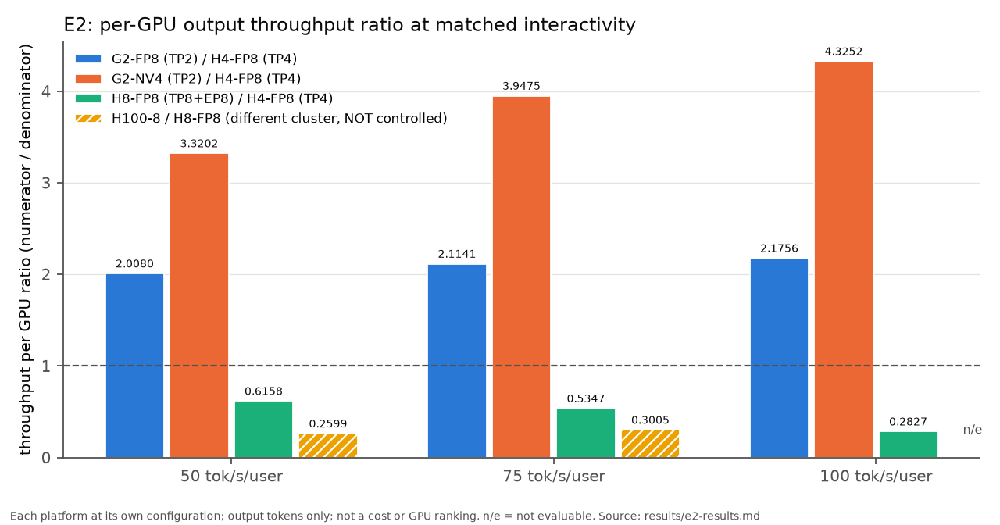

# moe-serving-lab

Serving one large MoE model on Hopper and Grace-Blackwell under an agentic multi-turn workload:
measurement, attribution, correctness.

> Status: the main study (E1–E4) ran on 2026-10-15/16 and is scored; start with
> [`main-study/SUMMARY.md`](main-study/SUMMARY.md). Two CPU-only follow-ups in [`sim/`](sim/) re-use its logs. Three
> case studies are written up from earlier, independently scored runs.

## 1. Summary

- **Question.** One MoE model (Qwen3-235B-A22B-Instruct-2507, public FP8 and NVFP4 checkpoints), one SGLang nightly
  (`a6a8c56015b8`), one replay of public coding-agent sessions: how do GB200 FP8, GB200 NVFP4 and H200 FP8 differ in
  latency, throughput per GPU and prefix-cache reuse, and where does decode-step GPU time go?
- **Hardware.** 2–16 × GB200 and 2–8 × H200 for the 235B model, on one Slurm cluster
  ([`docs/hardware.md`](docs/hardware.md)), plus 8 × H100 on another cluster as an uncontrolled extra.
- **Findings** (each quoted from an independently scored results file; descriptive, no single-cause attribution):
  - Same 2 GPUs, one request at a time: TPOT p50 7.943 ms on GB200 FP8, 9.932 ms on H200 FP8, 6.625 ms on GB200
    NVFP4. NVFP4 is not shown lossless (30 GSM8K answers move against FP8, limit 20)
    ([E1](main-study/results/e1-results.md)).
  - Each platform at its own configuration, output throughput per GPU at 50 / 75 / 100 tok/s/user: GB200 FP8 TP2 ÷
    H200 TP4 = 2.0080 / 2.1141 / 2.1756; GB200 NVFP4 TP2 ÷ H200 TP4 = 3.3202 / 3.9475 / 4.3252; H200 TP8 + EP8 ÷
    TP4 = 0.6158 / 0.5347 / 0.2827 ([E2](main-study/results/e2-results.md)). Not a cost ratio or a GPU ranking.
  - nsys attribution of decode steps finds no single kernel class dominating the per-token GPU-time difference
    between GB200 TP2 and H200 TP4, under the preregistered rule, for either pair
    ([E4](main-study/results/e4-results.md)).
  - One untuned 16-GPU server across four GB200 nodes (round-robin dispatch over 16 attention-DP ranks) reaches
    0.02028 / 0.02781 of the one-node throughput per GPU at 50 / 75 tok/s/user ([E3](main-study/results/e3-results.md)).
    A cache simulation driven by its logs reproduces its low prefix-hit rate from round-robin dispatch alone, and estimates that
    session-sticky dispatch would raise its throughput about 2.3–2.7× (c = 4–16), which still leaves most of the
    per-GPU gap to one node ([`sim/cache_aware_routing`](sim/cache_aware_routing/); an estimate, not a measurement).



*E2, throughput per GPU of each numerator ÷ H200 TP4 at three interactivity targets; three registered launches
per configuration (two at three points, see the results file); output tokens only. Source: [`main-study/results/e2-results.md`](main-study/results/e2-results.md).*

## 2. Main study: same MoE, same agentic workload — H200 FP8 vs GB200 FP8 vs GB200 NVFP4

- Setup: Qwen3-235B-A22B-Instruct-2507 (public FP8 and NVFP4 checkpoints), one SGLang commit; 2 GPUs per arm in E1,
  each platform at its own configuration in E2–E4 (2 × GB200 TP2, 4 × H200 TP4, 8 × H200 TP8 + EP8, 4 and 16 × GB200,
  8 × H100 on another cluster).
- Workload: replay of public agent trajectories with multi-turn prefix reuse.
- Metrics: TTFT / TPOT / throughput at fixed concurrency, prefix-cache hit rate.
- Results: E1–E4, preregistered (except E4 Q3) and independently scored: [`main-study/results/`](main-study/results/), one-page
  overview in [`main-study/SUMMARY.md`](main-study/SUMMARY.md). Post-hoc CPU analyses of the same logs (not scored):
  [`main-study/results/posthoc-log-analyses.md`](main-study/results/posthoc-log-analyses.md).
- Attribution: where the time goes (nsys), and which kernels actually ran. Descriptive, not causal.
- Correctness: fixed eval with paired flips, logprob agreement against a reference.
- Limits: what these numbers do not show.

See [`main-study/`](main-study/).

## 3. CPU follow-ups (no new GPU runs)

| Folder | Question | Answer in one line |
|---|---|---|
| [`sim/attn_dp_vs_tp`](sim/attn_dp_vs_tp/) | Would attention-DP8 + EP8 beat the measured TP8 + EP8 on 8 × H200? | NVIDIA AIConfigurator, checked against the E4 step times, predicts DP8 slower at the batch sizes behind E2's targets and faster only at large batch and long context with balanced ranks |
| [`sim/cache_aware_routing`](sim/cache_aware_routing/) | How much of the 16-GPU result is lost prefix reuse from round-robin dispatch? | A cache model reproduces the logged hit rates (mean absolute error 0.27 pp over 51 points); session-sticky dispatch would lift the hit rate to 0.95–0.96, and an estimate puts throughput 2.3–2.7× higher, still far below one node per GPU |

Both are simulations or estimates built on the main study's logs, labelled as such inside; neither is a GPU
measurement.

## 4. Case studies

| # | Topic | Hardware | Evidence | Link |
|---|---|---|---|---|
| 01 | On a small engine, overlap scheduling hides almost all scheduler CPU time yet gains only 5 % throughput; splitting tokenize/detokenize work across processes cut burst TTFT p50 from 263 to 117 ms | 1 × RTX A4500 | preregistered, independently scored; one secondary prediction falsified | [01](case-studies/01-mini-sglang-cpu-overheads/) |
| 03 | An NVFP4 MoE decode kernel reported faster alone makes end-to-end TPOT 17.6–38.1 % slower | 1 × GB200 | preregistered, independently scored; public report | [03](case-studies/03-cake-nvfp4-moe-gb200/) |
| 04 | TensorRT-LLM's KV estimation probe ignores the host-memory budget and can be OOM-killed in a 16 GiB container | 1 × H200 | preregistered, independently scored; public report | [04](case-studies/04-trtllm-kv-probe-host-oom/) |

Case 02 is not published; the numbering is kept so that links stay stable.

## 5. Method

Preregistration before running, an A/A noise floor, independent scoring, a claim ceiling per result.
See [`docs/method.md`](docs/method.md).

## 6. Hardware notes

H200 vs GB200: host CPU architecture, GPUs per job, what differs from B200.
See [`docs/hardware.md`](docs/hardware.md).

## 7. Reproducing

Main study:

- **Pins.** Image digests, checkpoint revisions, the dataset revision and the replay input's sha256 are in
  [`main-study/prereg/e1-prereg.md`](main-study/prereg/e1-prereg.md) §2. The server flags, harness commit and job
  ids of every configuration are in [`main-study/README.md`](main-study/README.md#configurations-and-server-flags).
- **Replay input.** Built from the public dataset and the sampled ids by
  [`main-study/harness/load_trajectories.py`](main-study/harness/load_trajectories.py) (needs `pyarrow` and
  `transformers`; the original run used the pinned image). A CPU rebuild matched the registered sha256
  ([`sim/cache_aware_routing`](sim/cache_aware_routing/README.md#inputs)).

  ```bash
  python3 main-study/harness/load_trajectories.py --parquet <trajectories.parquet at dataset revision 35455389> \
      --ids main-study/sample/e1-sessions.txt --tokenizer <Qwen3-235B-A22B-Instruct-2507-FP8 at e156cb4e> \
      --out replay.jsonl
  sha256sum replay.jsonl   # baf4efba…d1f7ff, full value in e1-prereg.md §2
  ```

- **Serving runs.** [`main-study/harness/`](main-study/harness/) holds the launch wrapper and clients with
  placeholders for cluster-specific values; the Slurm wrappers that filled them in are not published.
- **Not stored here.** Model weights, trajectories, raw logs and profiler reports. The scripts in
  `main-study/analysis/` and `sim/` take the raw folder as an argument (`sim/cache_aware_routing` also needs a private
  map from launch label to folder); their small derived outputs are committed.
- **Tests (CPU only).** `cd main-study/analysis && python3 -m unittest discover -s tests`, and the same in
  `main-study/harness` (its client tests need `aiohttp`).

Each case study has its own Reproduce section.

## 8. Terms

| Term | Meaning here |
|---|---|
| TTFT / TPOT | time to first token; time per output token after the first, from the client's per-request records |
| c | closed-loop concurrency: number of replay workers, each running one session's turns in order |
| tok/s/user | interactivity: median per-request decode rate, (output tokens − 1) ÷ (end-to-end − TTFT); E2 compares platforms at matched values of it |
| TP / EP / attention-DP | tensor, expert and attention data parallelism (SGLang `--tp`, `--ep-size`, `--attn-dp-size`) |
| prefix hit rate | Σ cached prompt tokens ÷ Σ prompt tokens over all requests of a point (SGLang's radix prefix cache) |
| A/A floor | difference between two launches of the same arm; an arm difference counts as resolved only above a threshold derived from it (exact rule in each preregistration; [`docs/method.md`](docs/method.md) §2) |
| NVFP4 | NVIDIA's 4-bit floating-point format with FP8 block scales (ModelOpt checkpoint) |
| SU | the cluster's billing unit: H200 60 and GB200 100 SU per GPU-hour |

## 9. Prequel

Earlier deployment record: <https://github.com/Smallfu666/glm-5.2-sglang>

## 10. Acknowledgements and third-party licenses

Software, models and data used or referenced. Nothing below is redistributed in this repository.

| Item | Used in | License |
|---|---|---|
| [SGLang](https://github.com/sgl-project/sglang) | main study, 03 | see repository |
| [mini-sglang](https://github.com/sgl-project/mini-sglang) | 01 | MIT |
| [FlashInfer](https://github.com/flashinfer-ai/flashinfer) | 03 | see repository |
| [TensorRT-LLM](https://github.com/NVIDIA/TensorRT-LLM) | 04 | see repository |
| [Qwen/Qwen3-0.6B](https://huggingface.co/Qwen/Qwen3-0.6B) | 01 | Apache-2.0 |
| [nvidia/Qwen3-30B-A3B-NVFP4](https://huggingface.co/nvidia/Qwen3-30B-A3B-NVFP4) | 03 | Apache-2.0 |
| [Qwen/Qwen3-235B-A22B-Instruct-2507-FP8](https://huggingface.co/Qwen/Qwen3-235B-A22B-Instruct-2507-FP8) | main study | Apache-2.0 |
| [nvidia/Qwen3-235B-A22B-Instruct-2507-NVFP4](https://huggingface.co/nvidia/Qwen3-235B-A22B-Instruct-2507-NVFP4) | main study | see model card |
| [Qwen/Qwen3-235B-A22B-Instruct-2507](https://huggingface.co/Qwen/Qwen3-235B-A22B-Instruct-2507) | main study (BF16 reference) | Apache-2.0 |
| [Qwen/Qwen3-30B-A3B-FP8](https://huggingface.co/Qwen/Qwen3-30B-A3B-FP8) | main study (E4 profiler-overhead check) | Apache-2.0 |
| [meta-llama/Llama-3.1-8B-Instruct](https://huggingface.co/meta-llama/Llama-3.1-8B-Instruct) | 04 | see model card |
| [GSM8K](https://huggingface.co/datasets/openai/gsm8k) | 03, main study | MIT |
| [nebius/SWE-rebench-openhands-trajectories](https://huggingface.co/datasets/nebius/SWE-rebench-openhands-trajectories) | main study | CC-BY-4.0 |
| [NVIDIA AIConfigurator](https://github.com/ai-dynamo/aiconfigurator) (`aisimulate` 0.12.0) | `sim/attn_dp_vs_tp` | Apache-2.0 |

Dataset attribution: "OpenHands Trajectories with Qwen3-Coder-480B-A35B-Instruct", Trofimova et al., Nebius, 2025
([dataset card](https://huggingface.co/datasets/nebius/SWE-rebench-openhands-trajectories), revision `35455389`),
licensed under [CC BY 4.0](https://creativecommons.org/licenses/by/4.0/). Only sampled session ids are stored here
(`main-study/sample/e1-sessions.txt`). Changes made for the runs: the sampled sessions are tokenized with the
model's chat template (message fields reduced to role, content, tool calls and their ids) and cut at the first turn whose prompt
plus min(answer, 1,024) exceeds 32,768 tokens; the replay asks for at most 1,024 output tokens per turn
(`e1-prereg.md` §2).

## 11. Notes on how this was made

_TODO (author): decide whether and how to describe AI assistance before this repository is made public._
